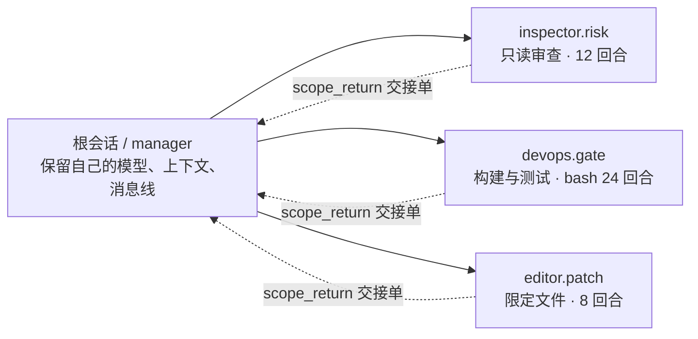

# Herdchestra

**把一个 AI 会话，变成一支有预算、有分工、有交付记录的团队。**

版本 10.1.0 · 宿主 omp 19.2+ · Bun 1.4.4+ · 源码可见，EULA 授权

Herdchestra 是 omp 的多 scope 编排插件：把一次会话拆成一棵带角色、预算和独立上下文的工作树。

---

## 一段对话，装不下真正的工作

今天的大多数 AI 编程会话仍是一条单线程：读文件、改代码、跑测试、写总结，全部挤在同一条上下文里。任务一长，问题随之而来。

- **串行**：审查、构建、修改本可同时进行，却只能排队。
- **污染**：子任务的探索过程灌进父会话，真正重要的结论被淹没。
- **失控**：没有回合上限，也没有墙钟；一个跑偏的探索能烧掉整晚。
- **越权**：只读的审查者也能改文件、跑命令，边界靠自觉。
- **失忆**：上下文一满就压缩，交接靠一段模糊的摘要。

Herdchestra 给 omp 会话加上的不是"又一个子代理"，而是一套**工作 scope**：每个 scope 有独立上下文、独立模型、独立预算、独立时钟和明确角色；父会话只收到一份可审计的交接单。

## 一个父会话，多个工作 scope



父会话调用 `scope_fork` 一次开出多个子 scope，然后继续做自己的事；每个子 scope 在自己的上下文里工作，结束时用 `scope_return` 提交一份报告；父会话用 `scope_join` 逐个接收。**父不会变成子，子也不会变成父。**

这不是线程库，也不是消息总线。它是会话内的一棵工作树：身份就是路径，结果就是记录。

## 核心能力

### 并行是默认值，不是优化项

一次 `scope_fork` 接收一个数组，数组里每一项就是一个独立 scope。审查、构建、改文件、查资料可以同时开始，互不等待。探针按角色报告空闲人手：**3 个 manager（含根）、1 个 devops、10 个 editor、10 个 inspector**。这是报告口径，不是硬上限；真正的准入约束是同一时刻只允许 1 个 devops 在跑。

### 角色即权限，路径即身份

每个 scope 路径都写成 `<角色>.<名字>`，例如 `inspector.risk`、`devops.gate`。角色只能收窄，不能越级：

| 角色 | 能做什么 | 不能做什么 |
|---|---|---|
| `manager` | 规划、分叉、汇合、回答 | 直接读写文件、跑命令 |
| `devops` | 全部宿主工具：shell、构建、测试、读写 | 同时只能有一个在跑 |
| `editor` | 读文件、改文件 | 不能执行命令、不能开子任务 |
| `inspector` | 只读检索、审查、联网查证 | 不能写、不能执行 |

想让审查者"只看不改"，不必在提示词里反复叮嘱；把它 fork 成 `inspector`，它手里根本没有写工具。

### 每个 scope 有自己的模型、预算与时钟

- **模型**：每个 fork 项可以指定模型（provider/model 或别名，可带思考级别）；省略则继承父 scope 的模型与思考级别，并复用同一段 prompt 前缀缓存，不为每个子任务重新预填充。
- **预算**：按工具分别给回合数，例如 `{ bash: 24, read: 8 }`。一个回合就是一次模型请求；超支的调用仍会执行，但会记进 `panhandled` 账本，让"预算"成为可核对的承诺。
- **时钟**：系统按会话的平均请求耗时与回合数推算墙钟，工具执行也计入其中。父会话在 `scope_join` 等待时，自己的时钟暂停。

### 中途接管，而不是推倒重来

发现一个 scope 跑偏了，用 `scope_abandon` 打断它；它会进入只能交报告的 `ABANDONED` 模式，交出当前发现后结束。要改方向，在同一路径下重新 fork：新 scope 继承原位置的上下文快照与缓存，不必从零开始读同一批文件。

### 上下文是预算，不是垃圾桶

- 子 scope 继承父级的上下文快照；同一模型、同一前缀，缓存继续命中。
- 一个 scope 的上下文超过上下文窗口的一半，就只剩"交报告"这一条路，避免在临界点上烧双倍价钱。
- `unfinished` 回卷保留最新报告和原始任务指令，而不是整段探索过程。
- 会话状态只追加、按回合写增量：实测 400 回合的会话，持久化写入量是逐回合全量快照的 **4.5%**。长会话不会越跑越慢、越存越大。

### 交付的是记录，不是另一段聊天

子 scope 必须带着一份 `dafny` 报告结束：结论、证据、未决项、下一步。父会话收到的就是这份记录，而不是几千行工具输出。记录进不了父上下文时，`scope_join` 会拒绝接收并保留子 scope 的结果，不会静默截断，也不会伪造成功。

### 全程可视

TUI 里，每个子 scope 的消息和工具调用都带路径标签。Web 控制台里，工具结果按类型渲染：终端保留 ANSI 颜色，编辑显示 diff，`js` 调用展开成脚本与逐次内部调用。

需要浏览器时，可选的 **Web 控制台**把本机的 omp 会话列成一张表：选中即接管，支持附件、追问与中断；历史会话可在原工作目录重新拉起（依赖 tmux）。控制台只绑定回环地址，URL 与令牌就是凭据。

### 目标模式：说完目标，跑到盖章

```text
/herd-goal 把 README 重写成商业介绍，补全安装步骤，并跑完链接与命令检查
```

根会话进入 `ROOT_AUTOPILOT`：不中途提问，自然停止会被引导回 `scope_return`，直到交出盖章答案。Esc 打断后目标模式仍在，下一条消息继续；裸 `/herd-goal` 立即关闭。

## 快速开始

### 前置

- [omp](https://github.com/can1357/oh-my-pi) 19.2 或更新版本
- Bun 1.4.4 或更新版本
- 可访问本仓库的 Git 凭据（私有仓库需要）
- Web 控制台需要 tmux；桌面托盘另需对应桌面运行时（Linux 已验证，macOS/Windows 托盘尚未验证）

```bash
omp --version
bun --version
```

### 安装

一条命令同时注册 TUI 插件与 Web 桥接（Web 静态资源需另行构建，见下文）：

```bash
omp plugin install https://github.com/PamelaSprin47685ghall/herdchestra-lite2
```

重启会话，然后确认：

```bash
omp plugin list          # 应显示 herdchestra-lite2@10.1.0
```

在会话里输入 `/herd`，会打印六个策略开关的当前值。TUI 能力此时已经可用。

### 第一个并行任务

不需要手写调度代码。直接用自然语言提出目标，模型会在内部开出 scope。一次典型的 fork 长这样：

```js
await api.scope_fork({
  forks: [
    {
      path: "inspector.risk",
      fsm: "states: 枚举改动面 → 逐条核对失败路径 → 记录 file:line 与严重度; transition: 证据不足时退回读取; parallel: 审查与复现两条线并行",
      profession: "You are a security reviewer in the tradition of Dan Kaminsky: evidence first, no unproven claim.",
      n: 12,
      targets: ["src", "host-omp/src"],
    },
    {
      path: "devops.gate",
      fsm: "states: 跑 lint 与测试 → 归类失败 → 单文件复现; transition: 3 次未复现则缩小输入; parallel: 无",
      profession: "You are a build engineer who reports only what actually ran.",
      n: 10,
      budget: { bash: 24, read: 8 },
    },
  ],
});
```

两项同时开始。父会话继续处理自己的部分，随后逐个接收：

```js
const record = await api.scope_join();
```

### Web 控制台（可选）

Web 静态资源不在 Git 仓库中，需要本地构建一次。构建依赖 DeerFlow 前端子模块：

```bash
git submodule update --init --recursive
(cd host-omp-ui/web && bun run install:safe)
(cd host-omp-ui && bun run build:web)
(cd host-omp && bun install)
omp plugin link .
```

重启会话后输入 `/web`，会显示本地 URL。若之前已用 `omp plugin install` 装过同一插件，先用 `omp plugin uninstall herdchestra-lite2` 移除，避免同一插件出现两份。

### 常用命令

| 命令 | 作用 |
|---|---|
| `/herd` | 打印全部策略开关的当前值 |
| `/herd <feature> <state>` | 切换并持久化一个开关，例如 `/herd scope adaptive` |
| `/herd-goal <instruction>` | 启动一次目标会话；裸命令关闭目标模式 |
| `/herd-diag` | 打印最近 64 条宿主诊断 |
| `/web` | 显示本地 Web 控制台 URL 与连接状态 |

六个策略开关决定注入模型的规则文本，与宿主的默认行为解耦：

| 开关 | 取值 | 默认 | 影响 |
|---|---|---|---|
| `chinese` | `off` / `on` | `on` | 中文思考与回复要求 |
| `testing` | `off` / `no-red` / `lean` | `lean` | 静态优先、聚焦验证、未跑检查的交接 |
| `constitution` | `off` / `core` / `full` | `full` | 工作纪律、边界与诚实报告 |
| `framing` | `off` / `plan` / `full` | `full` | 目标、模型、残差与决策 |
| `scope` | `off` / `adaptive` / `aggressive` | `aggressive` | 何时分叉、如何并行 |
| `workspace` | `off` / `personal` / `full` | `full` | 仓库约定、设计记录与元技能 |

同一组名字也是环境变量：`HERD_CHINESE`、`HERD_TESTING`、`HERD_CONSTITUTION`、`HERD_FRAMING`、`HERD_SCOPE`、`HERD_WORKSPACE`。优先级是显式环境变量 > 持久化状态 > 默认值。`HERD_HERD=off` 会关闭 `/herd` 与 `/herd-goal`。

## 适合谁，不适合谁

**适合**

- 用 omp 做长任务，希望调查、修改、验证同时推进的个人与团队。
- 需要给不同任务不同模型与预算，并事后核对每个 scope 用了多少回合、多少工具预算的团队。
- 要把"只读审查""可写补丁""可执行验证"变成硬边界，而不是提示词约定的组织。
- 长会话用户：希望上下文、磁盘和等待时间不随会话长度失控。

**不适合**

- 非 omp 宿主。Herdchestra 是 omp 插件，不是独立运行时。
- 需要开源再分发或二次销售的场景；许可是 EULA，不是 OSI 许可证。
- 跨机器分布式调度。scope 树位于本机单个进程内。
- 拖拽式可视化编排。这里的工作流由自然语言、角色与工具调用驱动。

## 质量与可靠性

仓库里有 **230 个测试文件**，覆盖核心域、两个宿主接线和架构棘轮：

```bash
bun test tests        # 核心 + 两个宿主插件 + 架构边界
bun run lint
bun run smoke:relay   # 对假宿主验证 fork/join 注册、拒绝、回卷
```

宿主冒烟测试直接加载真实的 `AgentSession`，分别验证扩展接缝与真实 Agent 循环下的消息顺序、前缀稳定性、独立历史数组：

```bash
OMP_HOST=~/path/to/oh-my-pi bun scripts/smoke-omp.mjs
OMP_HOST=~/path/to/oh-my-pi bun scripts/smoke-context.mjs
```

CI 固定 Bun 1.4.4，跟踪 omp 官方仓库的最新提交，从宿主源码构建原生模块并把缺失能力视为失败。宿主升级后，先让两条冒烟测试通过，再投入使用。

运行时失败会进入 64 条环形诊断，状态栏显示 `⚠ N`；`/herd-diag` 打印详情。会话状态按追加日志写入，最多每 64 次状态写入落一个检查点，恢复时从最近检查点重放，不重写整段历史。

## 许可与第三方声明

Herdchestra 采用[最终用户许可协议](LICENSE)：允许内部个人或商业使用；禁止再分发、转售、反向工程，或用于开发竞争产品。**源码可见，但不是开源软件。**

产品复用了 DeerFlow 的 MIT 许可 UI 组件与品牌素材，第三方声明见 [NOTICE](NOTICE) 与 [THIRD_PARTY_NOTICES](THIRD_PARTY_NOTICES)。本项目是独立二次开发，与 DeerFlow 项目及其作者无隶属、赞助或背书关系。

## 面向开发者

仓库包含三个包：核心 `herdchestra-lite2`（与宿主无关的引擎）、`host-omp`（omp 接线与插件入口）、`host-omp-ui`（独立的 Web 桥接）。核心对宿主的公开 API 只有一个 `createEngine`，宿主也只导入这一个值；边界由 `tests/architecture/` 下的棘轮与 ESLint 规则静态守住。

- 变更记录：[CHANGELOG.md](CHANGELOG.md)
- 宿主接线说明：[host-omp/README.md](host-omp/README.md)
- Web 桥接说明：[host-omp-ui/web/README.md](host-omp-ui/web/README.md)
- 设计记录：[.agent/skills/scope-orchestration/SKILL.md](.agent/skills/scope-orchestration/SKILL.md)
